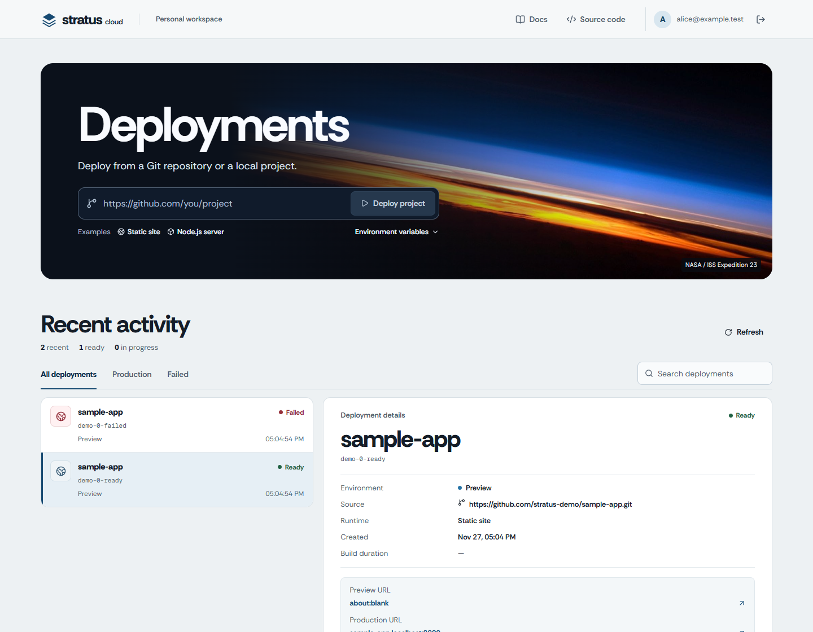
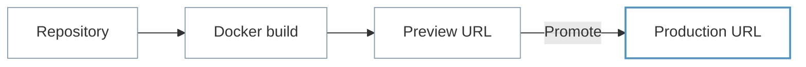

<h1 align="center">Stratus Cloud</h1>

<p align="center"><strong>Deploy web apps on your own infrastructure.</strong></p>

<p align="center">
  Build a static site or Node.js app from Git, follow the build live, and open a preview before you ship.
</p>

<p align="center">
  <a href="#quick-start">Quick start</a> ·
  <a href="#deployment-flow">Deployment flow</a> ·
  <a href="#tech-stack">Tech stack</a> ·
  <a href="docs/linux-compose-install.md">Linux install</a>
</p>

<p align="center">
  <a href="https://github.com/gxmngi/stratus-cloud/actions/workflows/ci.yml"></a>
  <a href="LICENSE"></a>
</p>



*Stratus workspace with sample deployments.*

## Deployment flow



1. **Pick a source.** Paste a public GitHub URL. Stratus checks the selected folder and shows the detected build command and output folder when available.
2. **Watch the build.** Follow live logs while Docker builds the app. Choose a different project folder or override the build settings when needed.
3. **Open the preview.** Every successful release has its own preview URL. The first successful release also sets the production URL.
4. **Ship a later release.** Promote its preview to the same production URL. Roll back from the dashboard to restore the previous release.

Supported targets are static sites and Node.js servers. Builds that need the Flutter SDK are currently unsupported.

## Tech stack

| Layer | Stack | What it does |
| --- | --- | --- |
| [Dashboard](apps/web) |   | Repository checks, release controls, and build logs |
| [API and builder](services) |   | Account sessions, deployment requests, and build execution |
| [Build containers](services/builder) |  | Runs builds in separate containers and starts Node.js apps |
| [Queue and storage](services/api) |   | Redis queues builds and carries log events. SQLite stores deployment records and production selections. |
| [Edge proxy](services/proxy) |  | Serves static files and routes requests to Node.js apps |

## Quick start

You need Git, Node.js 22, Go 1.27.4 or later, and Docker Desktop set to Linux containers.

```bash
git clone https://github.com/gxmngi/stratus-cloud.git
cd stratus-cloud
npm --prefix services/api ci
npm --prefix services/builder ci
npm --prefix apps/web ci
npm run dev
```

1. Open the [local sign-in page](http://localhost:3000/login) and use the demo account `alice@example.test` with password `Stratus local Alice demo 2026`.
2. Select **Static site** to load `fixtures/demo-app`, then select **Deploy project**.
3. When the deployment is **Ready**, open **Preview**. Try the **Node.js server** example to deploy an app with an HTTP server.

The launcher keeps local development data in a separate database. For UI work without Docker, run `npm run dev:auth`. See the [local deployment guide](docs/local-deployment.md) for ports and troubleshooting.

## Guides

| I want to… | Read |
| --- | --- |
| Host Stratus on Linux with HTTPS | [Linux Compose installation](docs/linux-compose-install.md) |
| Deploy automatically on a GitHub push | [GitHub webhook setup](docs/auth-readiness.md#websocket-and-webhooks) |
| See how builds recover and retry | [Build recovery](docs/build-recovery.md) |
| Work on the dashboard and browser tests | [Interface guide](docs/interface-design.md) |

<details>
<summary><strong>Run the project checks</strong></summary>

Install dependencies as shown in [Quick start](#quick-start). Before the first browser run, install Chromium with `npm --prefix apps/web exec -- playwright install chromium`.

| Area | Commands |
| --- | --- |
| Dashboard | `npm --prefix apps/web run lint` · `npm --prefix apps/web run build` · `npm --prefix apps/web run test:e2e` |
| API and builder | `npm --prefix services/api test` · `npm --prefix services/builder test` |
| Proxy | `go -C services/proxy test ./...` |
| Docker release flow | `npm run test:deploy` · `npm run test:workspace` |

Run the Docker checks against the [local stack](docs/local-deployment.md).

</details>

## License

[MIT](LICENSE). Maintained by [Rusdan Lamsa (@gxmngi)](https://github.com/gxmngi).
