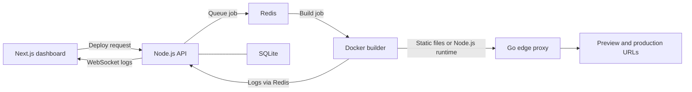

# Stratus Cloud

**Build, preview, and deploy web apps on your own infrastructure.**

Stratus Cloud is a self-hosted deployment platform for static sites and Node.js
servers. Give it a Git repository. It builds the project in Docker, streams the
build logs, and gives each successful release a preview URL.

[Run locally](#run-locally) · [Install on Linux](docs/linux-compose-install.md) ·
[How it works](#how-it-works) · [Run the checks](#run-the-checks) ·
[CI](https://github.com/gxmngi/stratus-cloud/actions/workflows/ci.yml)


*Workspace screenshot using sample deployments.*

## Deploy and manage releases

| Task | What Stratus does |
| --- | --- |
| Check a repository | For a public GitHub repository, check the selected folder before queuing. The workspace shows the detected framework, build command, and output folder when available. |
| Configure a build | Choose the project folder, override the build command or output folder, and add environment variables for a manual deploy. |
| Review a release | Open its preview URL and inspect live or saved build logs. Node.js deployments also show runtime metrics when available. |
| Update production | The first successful deployment sets the production URL. Promote a later preview to that URL or roll back to the previous release. |
| Automate or clean up | Configure a GitHub push webhook to queue deployments. Delete an individual preview or remove an entire project and its deployments. |

Flutter Web builds that require the Flutter SDK are currently unsupported.

## Run locally

Install Git, Node.js 22, Go 1.27.4 or later, and Docker Desktop with Linux
containers. Run these commands from the repository root.

```bash
npm --prefix services/api ci
npm --prefix services/builder ci
npm --prefix apps/web ci
npm run dev
```

1. Open the [local sign-in page](http://localhost:3000/login). Use
   `alice@example.test` and `Stratus local Alice demo 2026` for this local
   development instance.
2. Choose **Static site** to fill in `fixtures/demo-app`. Select **Deploy project**.
3. Wait for **Ready**, then open the **Preview** link in the selected release.
   Choose **Node.js server** to try a deployment with a running server.

The local launcher uses a dedicated development database. Open the
[local deployment guide](docs/local-deployment.md) for service ports and
troubleshooting. To work on sign-in or the dashboard without Docker, use
`npm run dev:auth`.

## How it works



- [Dashboard](apps/web) handles sign-in, repository checks, release management, and logs.
- [API](services/api) owns sessions, deployment records, and production aliases.
- [Builder](services/builder) builds in Docker and starts Node.js runtimes.
- [Proxy](services/proxy) serves static files and forwards requests to Node.js apps.

See [Linux installation](docs/linux-compose-install.md) for published images,
HTTPS, GitHub webhooks, and dependency caches. See [build recovery](docs/build-recovery.md)
for worker recovery and retry behavior. The [interface guide](docs/interface-design.md) describes the workspace controls and browser checks.

## Run the checks

| Command | Coverage |
| --- | --- |
| `npm --prefix apps/web run lint` and `npm --prefix apps/web run build` | Dashboard lint, types, and production build |
| `npm --prefix apps/web run test:e2e` | Browser checks for auth, repository validation, workspace controls, and accessibility |
| `npm --prefix services/api test` and `npm --prefix services/builder test` | API and builder tests |
| `go -C services/proxy test ./...` | Go proxy tests |
| `npm run test:deploy` and `npm run test:workspace` | Real Docker builds, previews, and changes to the production alias |

Before the first browser run, install Chromium with `npm --prefix apps/web exec -- playwright install chromium`.
Follow the [local deployment guide](docs/local-deployment.md) to run the Docker
checks against a local stack.

## License

[MIT](LICENSE). Maintained by [Rusdan Lamsa (@gxmngi)](https://github.com/gxmngi).
