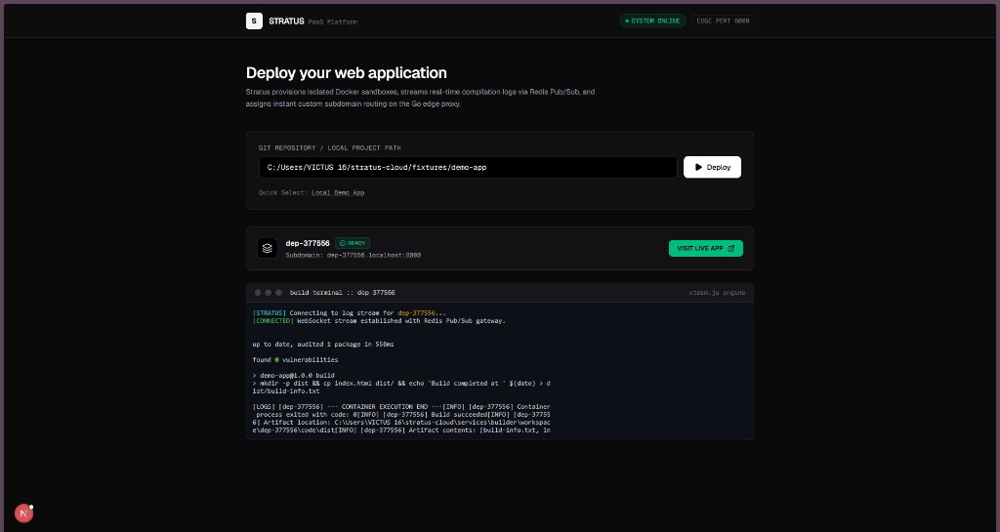
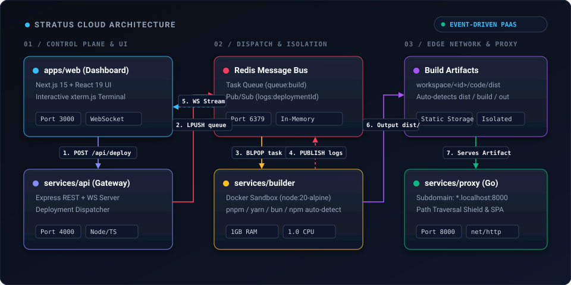
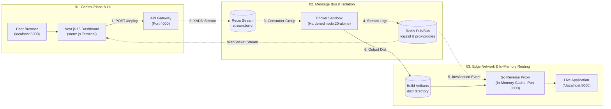

# Stratus Cloud

<p align="left">
  
  <a href="https://github.com/gxmngi/stratus-cloud/actions/workflows/ci.yml"></a>
  
  
  
  
  <a href="LICENSE"></a>
</p>

> A lightweight, self-hosted Cloud Deployment Platform (Mini-Vercel / PaaS) built from scratch with Next.js 15, Go, Docker, and Redis.



Stratus Cloud is an educational, production-modeled Platform-as-a-Service (PaaS). It automates the entire lifecycle of web applications: pulling Git repositories, executing isolated builds inside ephemeral Docker containers, streaming compilation logs in real time to the browser, and serving deployments through a high-performance Go reverse proxy with dynamic subdomain routing.

---

## Key Architectural Highlights

* **Polyglot Monorepo Design:** Clean separation of concerns featuring a Next.js 15 UI, a TypeScript Builder & Orchestrator, and a high-performance edge proxy written in Go.
* **Isolated Ephemeral Sandboxes & Linux Security Hardening:** Every build executes inside a throwaway Docker container (`node:20-alpine`) with strict resource constraints (1GB RAM, 1GB Swap, 1.0 CPU quota, `PidsLimit: 256` fork-bomb defense), root capability dropping (`CapDrop: ['ALL']`), and `no-new-privileges:true` kernel execution fences.
* **Intelligent Package Manager Auto-Detection:** Inspects project root files on the fly and dynamically switches between `pnpm`, `yarn`, `bun`, and `npm` without requiring manual configuration.
* **In-Memory Go Edge Proxy & Dynamic Cache Invalidation:** Sub-millisecond $O(1)$ in-memory routing table with pre-warmed connection pools and zero-disk per-request I/O. Supports instant hot-reloading via Redis Pub/Sub (`proxy:routes`) and internal REST control planes.
* **Zero-Downtime Blue-Green Project Aliases:** Atomic production traffic routing (`http://<project-slug>.localhost:8000`) with persistent SQLite state and 1-click instantaneous promotion from preview deployments.
* **At-Least-Once Resilient Job Pipeline:** Task ingestion powered by Redis Streams (`XADD`/`XREADGROUP`) with consumer groups, automatic crash recovery (`XAUTOCLAIM`), and 15-minute container execution timeout fencing.
* **Decoupled Real-Time Log Pipeline:** Completely separates build workers from web clients using Redis Pub/Sub channels and WebSockets, streaming container `stdout`/`stderr` line-by-line directly to an embedded `xterm.js` terminal emulator.

---

## Distributed System Architecture

<p align="center">
  
</p>

<details>
<summary><b>View Architecture Execution Pipeline Breakdown</b></summary>

### Sequential Execution Matrix

| Stage | Source → Target | Action | Transport / Protocol |
| :--- | :--- | :--- | :--- |
| **1. Ingest** | `apps/web` → `services/api` | Dispatches deployment trigger | HTTP POST (`/api/deploy`) |
| **2. Enqueue** | `services/api` → Redis | Pushes task to resilient Stream | Redis Stream `XADD stream:build` |
| **3. Dequeue** | Redis → `services/builder` | Worker pulls task via consumer group with auto-claim recovery | Redis `XREADGROUP` / `XAUTOCLAIM` |
| **4. Sandbox** | `services/builder` → Docker | Provisions hardened ephemeral container (CapDrop, PidsLimit) | Docker Engine API (`node:20-alpine`) |
| **5. Stream** | Docker → Redis Pub/Sub | Publishes real-time build logs | Redis `PUBLISH logs:<id>` |
| **6. Relay** | Redis Pub/Sub → `apps/web` | Forwards log stream to UI | WebSockets (`ws://localhost:4000`) |
| **7. Register** | `services/builder` → Edge Proxy | Registers dynamic route in-memory & broadcasts invalidation | Redis Pub/Sub `proxy:routes` & REST API |
| **8. Serve** | Client → `services/proxy` | Resolves preview & production alias traffic from in-memory cache | Go Reverse Proxy (`:8000`) |

### Topology Flowchart



</details>

---

## Repository Structure

```text
stratus-cloud/
├── apps/
│   └── web/              # Next.js 15 Developer Dashboard with xterm.js
├── services/
│   ├── api/              # REST Orchestrator API & WebSocket Gateway (Node/TS)
│   ├── builder/          # Hardened Docker Sandbox Build Engine (Dockerode + Redis Streams)
│   └── proxy/            # High-Performance In-Memory Edge Reverse Proxy (Go)
├── fixtures/
│   └── demo-app/         # Minimal, zero-bloat test application
└── assets/               # Architecture diagrams and preview assets
```

---

## Getting Started

### Prerequisites
* [Node.js](https://nodejs.org/) v20+
* [Go](https://go.dev/) v1.22+
* [Docker Desktop](https://www.docker.com/products/docker-desktop/) (Engine running)
* [Git](https://git-scm.com/)

### 1. Start Redis Message Broker
```bash
docker run -d --name stratus-redis -p 6379:6379 redis:alpine
```

### 2. Start the Go Edge Proxy (Port 8000)
```bash
cd services/proxy
go run main.go
```

### 3. Start the Builder Worker Daemon
```bash
cd services/builder
npm install
npx tsx src/index.ts
```

### 4. Start the API & WebSocket Gateway (Port 4000)
```bash
cd services/api
npm install
npx tsx src/index.ts
```

### 5. Start the Developer Dashboard (Port 3000)
```bash
cd apps/web
npm install
npm run dev
```

Open [http://localhost:3000](http://localhost:3000) in your browser, enter any Git repository or local fixture path (`fixtures/demo-app`), click **Deploy**, and watch your application build and deploy with live streaming logs.

---

## Engineering Design Decisions

| Subsystem | Technology | Architectural Rationale |
| :--- | :--- | :--- |
| **Edge Reverse Proxy** | **Go (`net/http`)** | Sub-millisecond latency, in-memory $O(1)$ lock-free read route cache, pre-warmed connection pools, real-time cache invalidation via Redis Pub/Sub, zero third-party dependencies. Hardened with path traversal guards and production HTTP timeouts. |
| **Production Aliases** | **SQLite + Dynamic Routing** | Instantaneous zero-downtime blue-green traffic swapping. Maps project slugs (`<slug>.localhost:8000`) atomically to active production deployments. |
| **Resilient Task Pipeline** | **Redis Streams (`stream:build`)** | Replaced fragile `BLPOP` queues with persistent consumer groups. Guarantees at-least-once execution with `XACK`, automatic orphaned job recovery (`XAUTOCLAIM`), and 15m container execution fencing. |
| **Sandbox Execution** | **Hardened Docker Engine API** | Complete container isolation for untrusted user code. Enforces 1GB RAM limits, `PidsLimit: 256`, `CapDrop: ['ALL']`, `no-new-privileges: true`, bounded swap, and host credential environment blocklist. |
| **Message Broker & Logs** | **Redis (Streams + Pub/Sub)** | Decouples the build worker fleet from the WebSocket gateway. Allows independent horizontal scaling of workers across multiple machines. |
| **Developer Dashboard** | **Next.js 15 + xterm.js** | Server-side rendering paired with client-side interactive terminal emulator via WebSockets for raw container `stdout`/`stderr` streaming and 1-click blue-green promotion. |

---

## Security Guardrails

1. **Kernel Privilege & Capability Dropping:** Build and runtime containers drop all root Linux capabilities (`CapDrop: ['ALL']`) with `no-new-privileges: true` set to prevent container escape and privilege escalation.
2. **Fork-Bomb & Resource Denial Mitigation:** Enforces strict process table quotas (`PidsLimit: 256` for builder containers, `512` for long-lived runtime services), 1.0 CPU quota, 1GB RAM, and 1GB Swap to prevent noisy neighbor starvation.
3. **Host Credential Leakage Guard:** Dynamic environment sanitizer filters out sensitive system environment variables (`AWS_*`, `TOKEN*`, `SECRET*`, `DOCKER_*`) before injecting user configurations into untrusted containers.
4. **Execution Timeout Guard:** Ephemeral builder containers are actively monitored with a 15-minute watchdog timer; hung or unresponsive build processes are forcibly aborted and cleaned up.
5. **Path Traversal Shield:** The Go Edge Proxy verifies that all requested static assets resolve strictly within the deployment's `dist/` directory via `filepath.Rel()`. Any attempt to escape the directory is denied with HTTP 403.
6. **Subdomain Strict Regex:** Subdomains are sanitized with `^[a-zA-Z0-9_-]+$` preventing injection of directory traversal separators in the `Host` header.
7. **Slowloris & Timeout Protection:** The HTTP server configures strict `ReadHeaderTimeout`, `ReadTimeout`, `WriteTimeout`, and `IdleTimeout` bounds to mitigate socket exhaustion attacks.

---

## License

Distributed under the [MIT License](LICENSE). Maintained by [Rusdan Lamsa (@gxmngi)](https://github.com/gxmngi).