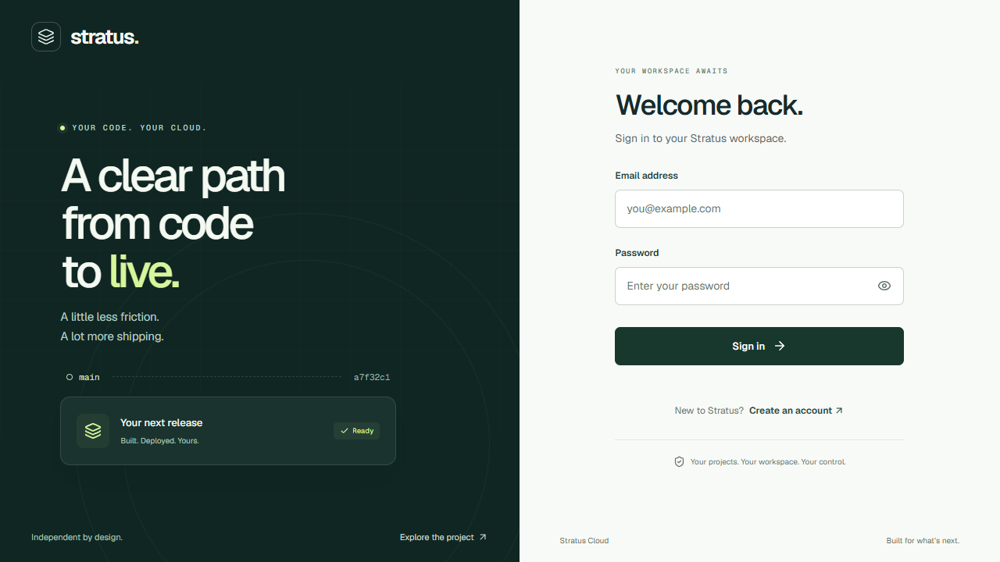

# Authentication and workspace access

The login and registration pages use a responsive split layout with a compact
mobile form. Session-protected workspace access is enforced by the API; the
client gate handles navigation and prevents private-state flashes.



## Start local development

For real builds, run `npm run dev` at the repository root and follow
[Real local deployment](local-deployment.md). The commands below describe the
auth-only mode used to work on forms without running build infrastructure.

Use Node.js 22. From `services/api`, run:

```powershell
npm ci
npm run dev:auth
```

This command seeds and starts the API on loopback only, port 4000 (or `PORT`). It always selects
`services/data/auth-dev/stratus.db`, regardless of an inherited `DATA_DIR`, and
refuses to run with `NODE_ENV=production`. It does not migrate or seed the regular
database. By default `dev:auth` runs offline: authentication, saved log replay
and project lists work without Redis. Deployment mutations/webhooks and live streams
return 503 immediately. For actual builds/live logs, set `AUTH_DEV_OFFLINE=0`
before starting `dev:auth`, and supply Redis on `127.0.0.1:6379` plus the builder
and proxy services. To start a local Redis instance when needed:

```powershell
docker run -d --name stratus-auth-redis -p 6379:6379 redis:7-alpine
```

If that name or port already belongs to an existing Redis service, reuse it.
`npm run seed:dev` prepares the same dataset without starting a server. Running
it again preserves existing users and does not duplicate sample projects/logs.

In another terminal, start the web app from `apps/web` with `npm run dev`.
Use `http://localhost:3000` consistently; mixing `localhost` and `127.0.0.1`
changes the cookie/site context. Open `/login` to sign in or `/register` to create
an account. The workspace redirects signed-out visitors to `/login`.

| Local account | Password |
| --- | --- |
| `alice@example.test` | `Stratus local Alice demo 2026` |
| `bob@example.test` | `Stratus local Bob demo 2026` |

These are disposable development credentials, never production accounts. Each
account owns one project and two sample deployments (READY and FAILED), using the
same repository URL with separate project IDs and slugs. These deployments are
sample metadata; no build, application container or public preview was created.
Their preview URL is `about:blank`.

## Frontend contract

Use `authApi` and `ApiError` from `apps/web/src/lib/api.ts` in Client Components:

```typescript
const { user } = await authApi.login(email, password);
const { user: restoredUser } = await authApi.me();
await authApi.logout();
```

All requests include credentials. Never place a session token in localStorage,
React state or a query string. The API sets an HttpOnly, SameSite=Strict cookie
with `/api` path and a seven-day expiry. HTTPS dashboard origins enable Secure.
Deploy dashboard and API on the same site (for example `app.example.com` and
`api.example.com`), or use a same-origin reverse proxy. Cross-site hosting will
not work with the current Strict cookie policy. The deployed apps themselves
must not share the dashboard/API trust boundary.

| Method/path | Request | Success |
| --- | --- | --- |
| POST `/api/auth/register` | `{email,password}` | 201 `{user}`; does not log in |
| POST `/api/auth/login` | `{email,password}` | 200 `{user}` plus cookie |
| GET `/api/auth/me` | none | 200 `{user}` |
| POST `/api/auth/logout` | none | 204; revokes session and clears cookie |

User shape: `{id: string, email: string, created_at: number}`. Timestamps are Unix
milliseconds. Passwords accept 15–128 JavaScript string code units; spaces are
preserved. Email is trimmed and lowercased. Error bodies are `{error: string}`.

| Status | UI behavior |
| --- | --- |
| 400 | Show validation error |
| 401 | Login: show generic credential error; session restore: show login |
| 403 | Origin/configuration problem; do not retry automatically |
| 404 | Resource unavailable; do not reveal another owner's data |
| 409 | Registration email unavailable |
| 413 | Request body too large |
| 429 | Show retry message; `ApiError.retryAfter` contains seconds from Retry-After |
| 500/503 or network error | Show service unavailable and allow a manual retry |

Register/login share a limit of 20 requests per IP in 15 minutes. The limiter
currently uses per-process memory. Configure a shared store and trusted proxy
topology before scaling across multiple API instances. No email verification,
password reset, MFA or social login is implemented in this milestone.

All browser mutations require the exact `DASHBOARD_ORIGIN` header, including
logout. Browsers supply Origin themselves; do not try to set it in frontend code.
For command-line HTTP calls, supply it explicitly. Default configuration:

```text
DASHBOARD_ORIGIN=http://localhost:3000
NEXT_PUBLIC_API_URL=http://localhost:4000
```

`DASHBOARD_ORIGIN` has no trailing slash. `NEXT_PUBLIC_API_URL` is a web build-time
setting. Compose loads the root `.env`; direct `npm start` uses shell environment
variables and does not automatically load the root `.env`.

### Session behavior in the UI

1. The session provider checks `/me` on load, periodically while signed in and on
   return to a tab. A pending screen prevents a flash of private workspace content.
2. Forms provide visible labels, autocomplete hints, keyboard focus, password
   reveal, inline validation, a focused error summary and reduced-motion support.
3. Registration shows a success screen and asks the user to sign in.
4. Login fetches the current user's workspace. Logout/session expiry unmounts it,
   closing streams, stopping polling and dropping private component state.
5. BroadcastChannel propagates logout/account changes across tabs. Requests from
   an older session cannot expire a newly accepted session.
6. Duplicate submissions are blocked; 429 honors Retry-After with a waiting period.
7. Use a second browser profile/private window for another simultaneous account: cookies
   are shared between tabs in the same browser profile.

## Existing database migration

Stop the API while performing an operator migration. From `services/api`, with
`DATA_DIR` set to the intended database directory (unset uses `services/data`):

```powershell
npm run db:backup
npm run db:migrate
npm run projects:claim
```

Backup uses SQLite's backup API so WAL contents are included, and writes a unique
file under the selected data directory's `backups/`. Migrate preserves project,
deployment and log records; old projects remain unassigned. It removes the old
global repository uniqueness constraint, replacing it with uniqueness per owner.
Slugs remain globally unique for routing. Repeated migrations are supported.

`projects:claim` previews unassigned projects without changing ownership (it may
initialize schema). Register your real account against the regular API, then
explicitly assign selected project IDs:

```powershell
npm run projects:claim -- --email you@example.com --project PROJECT_ID --apply
```

Repeat `--project` for additional IDs. Claims are all-or-nothing and cannot take
another owner's projects. Do not expose this operator CLI as an HTTP endpoint.
No real account/password is generated automatically and no existing project is
assigned to the first person who registers. To restore a backup, stop the API,
copy the backup to a new directory as `stratus.db`, and point `DATA_DIR` there.
Keep the old directory intact until restoration is verified.

`npm start` uses the regular database. The API Docker image includes operator
scripts; run them with `docker compose -f docker-compose.prod.yml exec api npm run ...`.

## WebSocket and webhooks

Logs connect to `/api/logs?deploymentId=...` using `logStreamUrl(id)`. The browser
automatically supplies the cookie. Upgrade requests check origin, session and
ownership before creating a Redis subscriber. Access is rechecked every second
and before every outgoing log message; revocation/expiry closes with code 1008.
Application preview URLs remain public; platform logs and management APIs are private.

The GitHub webhook secret is operator-controlled and bypasses browser sessions.
Use `/api/webhooks/github/PROJECT_ID` to select an existing owned project; the
payload repository must match it and the HMAC signature must be valid. The old
`/api/webhooks/github` endpoint only deploys when exactly one owned project matches
the repository. It ignores ambiguous, unassigned or unknown projects.

## Verification

```powershell
# services/api
npm test
npm run typecheck

# apps/web
npm run build
npx playwright install chromium
npm run test:e2e
```

Tests use separate temporary databases and do not seed or clear regular data.
They cover authentication, ownership, HTTP authorization, WebSocket revocation,
legacy migration, operator claims and repeatable development data. Redis/Docker
side effects in authorization tests use fakes; a real deployment end-to-end test
is a separate milestone. Browser tests start their own API and web servers on
ports 4402 and 3100, with a temporary database separate from regular/development
data. They exercise real session cookies, registration, errors, reload, logout,
cross-tab behavior, expiry, keyboard use, mobile layout and automated axe checks.
Automated accessibility checks do not replace manual assistive-technology testing.

Production dependencies pass `npm audit --omit=dev`. The full development tree
still reports moderate minimatch advisories through ESLint dependencies; these
require a separate compatible toolchain update. The Next.js runtime was updated
to 16.4.4 in this milestone.
