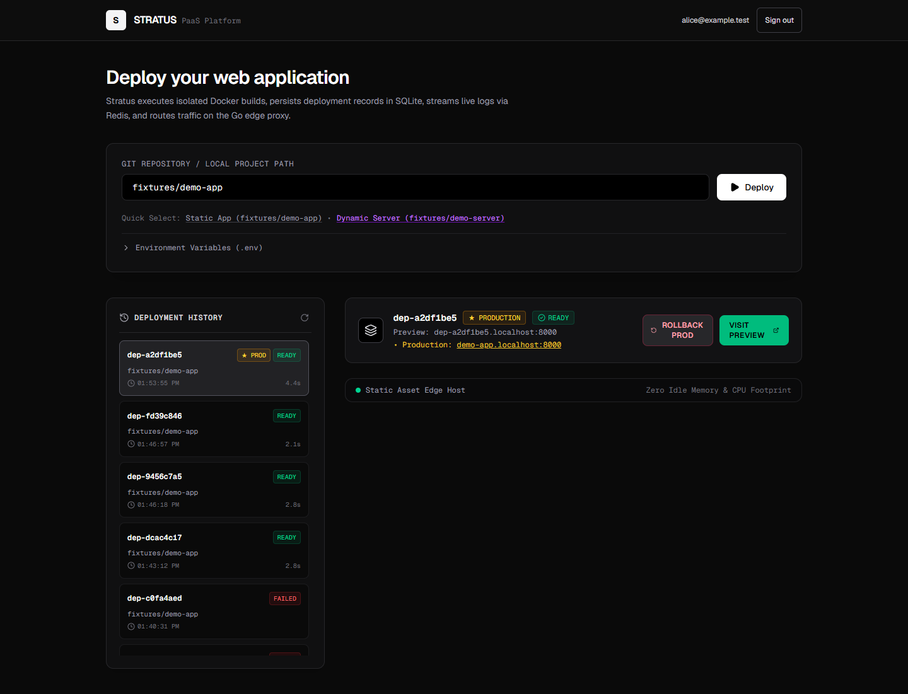

# Real local deployment

Run the complete local stack from the repository root with `npm run dev`.
The command requires Node.js 22, Go 1.27.4+, Docker Desktop with Linux containers, and
dependencies installed with `npm ci` in `services/api`, `services/builder` and
`apps/web`. On Windows, the launcher uses the active Docker context's named pipe
and passes the same absolute workspace path to API, builder and proxy.



## Services

| Service | Local address | Purpose |
| --- | --- | --- |
| Web | `http://localhost:3000` | Login and workspace |
| API | `http://localhost:4000` | Sessions, deployment records and management |
| Proxy | `http://localhost:8000` | Serves preview/production subdomains |
| Redis | `127.0.0.1:6379` | Build stream, logs and route notifications |

The launcher starts Docker Desktop if necessary, checks required images, creates
`stratus-local-redis` with a persistent named volume and restart policy, then
starts the local processes. Existing unrelated containers are left alone.
Ctrl+C stops only the processes launched by this command; Redis remains available.
API and proxy use loopback listeners in this local configuration.
The local launcher sets `DISABLE_SCALE_TO_ZERO=1` to keep application containers
awake while developing. Other launch configurations retain automatic idle sleep.

If an old Compose deployment from this repository auto-starts and owns the ports,
stop its platform services before using the local launcher:

```powershell
docker compose -f docker-compose.prod.yml stop api builder proxy web
```

This does not delete volumes or application containers. Stop older manually run
Stratus terminals with Ctrl+C as well. The launcher reports occupied ports rather
than terminating unknown processes automatically.

## Deploy the fixture

1. Open `http://localhost:3000/login`.
2. Use `alice@example.test` / `Stratus local Alice demo 2026`.
3. Enter `fixtures/demo-app` and select **Deploy project**.
4. Follow QUEUED → BUILDING → READY and inspect live/persisted logs.
5. Open the preview, `http://DEPLOYMENT_ID.localhost:8000`.
6. Use **Promote to production** on a later ready deployment, then use **Roll back** on the production deployment.

The local launcher uses `services/data/auth-dev/stratus.db` and the workspace
under `services/builder/workspace`. It does not use the regular database or
existing Compose volumes. Sample records named `demo-*` remain UI examples;
records named `dep-*` created by an actual deploy correspond to real builds.
The first real deployment becomes the project's production alias automatically.
Later deployments remain previews until promoted.

For authentication UI development without Docker, use `npm run dev:auth` from
the root. That separate mode intentionally disables deployment actions and live
log streams. See [Authentication](auth-readiness.md) for account/session details.

## Repeatable lifecycle check

With the full stack running, execute in another root terminal:

```powershell
npm run test:deploy
```

This uses the disposable Alice/Bob accounts and changes the local fixture
project's production alias. It builds release files with distinct content and
checks the actual proxy responses through these steps:

- both accounts authenticate;
- the edge HTTP control plane is private;
- the first Docker build streams real logs through an authenticated WebSocket
  and produces an accessible static preview;
- a second preview does not replace the production alias automatically;
- Bob cannot inspect logs/metrics, promote, roll back or delete Alice's deployments;
- promotion serves release two and rollback serves release one again;
- deleting the superseded preview preserves the active production deployment.

The final active preview is retained for inspection. A report with its URLs is
saved in `services/data/local-deploy-report.json` (ignored by Git). Cookies and
passwords are not written into the report. The check verifies static deployments;
worker crash-recovery checks are described in [Build recovery](build-recovery.md).

For dynamic promotion and rollback, deploy `fixtures/demo-server` once as Alice,
then run:

```powershell
npm run test:deploy:dynamic
```

This checks the current production health response, builds a new dynamic preview,
promotes it, and rolls back to the original deployment. It samples 25 production
health requests during each switch and verifies the returned deployment IDs.
These 50 requests are a smoke check, not a load test or a guarantee of zero downtime.
The original production and new preview are retained; the report is written to
`services/data/dynamic-promote-report.json` (ignored by Git). Avoid concurrent
manual promotion or rollback of this project while the check runs.

Dynamic builds reserve host ports used by both running and stopped Stratus
containers so that a new deployment does not take a sleeping deployment's port.
Readiness requires a successful HTTP probe; an open TCP port alone is insufficient.

## Queue and failure behavior

New jobs are published only to Redis Stream `stream:build`. The worker does not
consume `queue:build`, avoiding the previous duplicate stream/list execution.
The consumer group begins at ID `0` so first-start queued jobs are not skipped.
Reported build outcomes are acknowledged; unexpected processing exceptions stay
pending for recovery rather than being acknowledged in a finally block.

If enqueueing fails, the API returns 503 within its bounded Redis command timeout
and marks the deployment FAILED with a retry message. Workspace cleanup rejects
invalid IDs/traversal before changing records or deleting files.

## Edge control plane

`/_internal/routes` is disabled unless `PROXY_CONTROL_TOKEN` is configured.
When enabled, requests require `Authorization: Bearer TOKEN`. The browser never
receives this operator token. Normal local routing uses Redis notifications, so
the HTTP control endpoint can remain disabled. Application content on a preview
subdomain cannot use the endpoint to modify another application's routes.

## Troubleshooting

- **Deployment actions disabled:** an older auth-only API is still running. Stop
  that terminal and use root `npm run dev`.
- **Port already in use:** stop the previous Stratus process or platform Compose
  services; do not start a second API on the same port.
- **Docker startup/update:** wait until `docker info` reports Linux containers,
  then rerun the launcher. A Desktop update may restart its engine.
- **Redis unavailable:** check `docker logs stratus-local-redis` and
  `docker exec stratus-local-redis redis-cli ping` (expected PONG).
- **Preview hostname fails in a command-line client:** browsers resolve
  `*.localhost` to loopback. The lifecycle check uses an explicit Host header with
  Node's HTTP client so it does not depend on the OS wildcard resolver.

This is a local development stack. Public hosting still needs a separate review
of build isolation, network boundaries, secrets, persistent logs, TLS, quotas and
recovery behavior before accepting untrusted repositories.
## Check a repository before deploying

Paste a public GitHub repository URL into the dashboard. Stratus reads the
repository's default branch and shows the detected framework, planned build
command, and typical output directory. This check reads metadata and does not
start a build. Flutter Web projects are identified before the dashboard offers
to deploy them.

Open **Build settings** to select a folder such as `apps/web` or to override the
build command and static output folder for this manual deployment. The output
folder is relative to the project folder and must contain `index.html`. An empty
setting preserves the existing automatic behavior. GitHub webhooks continue to
use automatic build settings.
